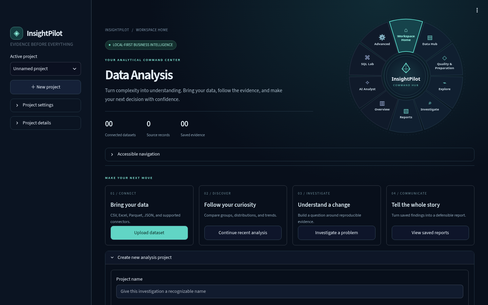

# InsightPilot

**Turn a data file into charts, answers and reports, all on your own computer.**

No account, no cloud and no coding needed.



## What it does

- **Opens your data:** CSV, Excel, Parquet and JSON, up to 100 million rows.
- **Checks quality:** finds missing values, duplicates and problem fields.
- **Makes charts:** trends, rankings, distributions and more, in a few clicks.
- **Builds dashboards:** Power BI-style report pages with DAX measures.
- **Answers questions:** an optional AI analyst runs on your computer through Ollama.
- **Creates reports:** save your findings and export them.

Your data stays on your computer unless you choose to connect an outside service.

## Quick start

You need [Git](https://git-scm.com/downloads) and [uv](https://docs.astral.sh/uv/getting-started/installation/). Then run:

```bash
git clone https://github.com/alimammadzada23/DA_project.git
cd DA_project
uv sync --locked
uv run streamlit run app.py
```

InsightPilot opens in your browser. To stop it, press **Control-C** in the terminal.

On a Mac, after the first run, you can double-click **Start InsightPilot.command** instead.

## How to use it

1. **Data Hub:** add your file.
2. **Quality & Preparation:** check your data and say what each column means.
3. **Explore:** make charts and find patterns.
4. **Investigate:** write down what you found.
5. **Reports:** turn your findings into a report.

Press **Save Project** in the left sidebar to keep your work. Nothing is saved until you do.

## Built with

Python · Streamlit · DuckDB · Plotly

## Learn more

- [Working with large tables](docs/LARGE_DATA.md)
- [BI Studio: dashboards and DAX](docs/BI_STUDIO.md)
- [Everyday use on a Mac](docs/MAC_EVERYDAY_USE.md)
- [Technical overview](docs/TECHNICAL_OVERVIEW.md)

## Run the tests

```bash
uv sync --locked --extra test
uv run pytest -q
```
