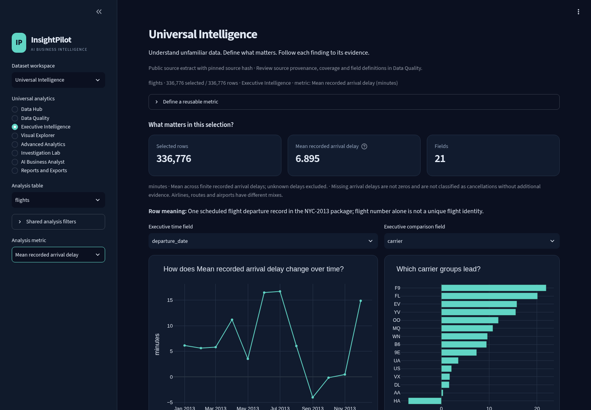
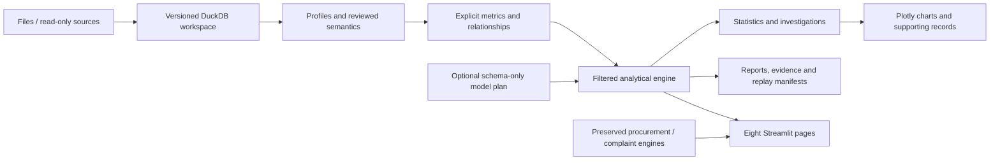

# InsightPilot — Evidence-led Data Intelligence

A local-first **Streamlit, DuckDB and Plotly** analytics application. Import
unfamiliar data, inspect its quality, review its meaning, define explicit metrics,
investigate differences and export reproducible evidence. Original procurement,
CFPB and mapped-upload workspaces are preserved.

**Implemented:** eight Universal Intelligence pages, multi-table imports,
conservative profiling, reversible preparation, safe metric expressions,
relationship validation, statistical tools, interactive exploration and
version-bound reports. Deterministic calculations need no AI connection.

[Implementation and acceptance status](docs/next-generation-validation.md) ·
[Usage guide](docs/universal-intelligence-guide.md) ·
[Technical audit](docs/next-generation-audit.md) ·
[Measured benchmarks](docs/next-generation-benchmarks.json) ·
[Real browser evidence](docs/next-generation-browser.json)

This is a tested working upgrade, **not a claim that every master-assignment
item is complete**. Two authentic cross-domain cases reconcile against independent
calculations. CFPB acquisition is blocked by HTTP 403; the reported 81,915-record
original file is absent. Live PostgreSQL/provider acceptance, native Mac and
Windows Power BI acceptance, and specialized capabilities remain unverified or
deferred. The status document gives the precise boundaries.



This screenshot uses the public NYC-2013 package extract. Screenshots beginning
`SYNTHETIC-` show controlled software examples, not genuine business findings.

## Install and run

From your existing checkout **containing these changes**, with
[uv](https://docs.astral.sh/uv/) installed:

```sh
uv python install 3.12
uv sync --frozen --extra test --python 3.12
uv run --frozen streamlit run app.py --server.port 8501 --server.headless false
```

Choose **Universal Intelligence → Data Hub**. Import files, inspect **Data
Quality**, approve roles, then define a metric in **Executive Intelligence**.
Supply its meaning, units and limitations. The explicit **Records** metric also
works immediately. Explore, investigate, inspect the underlying rows and report.

Changes are local to the development branch; no push or deployment is automatic.
Do not assume an older remote `feature/insightpilot` checkout has this upgrade.
The [historical README](docs/pre-upgrade-readme.md) preserves earlier workspace
documentation; the commands above supersede its branch-update advice.

Mac use is intended but the recorded execution evidence is Linux. No API key is
required for local analysis. Stop with Control-C. Data, databases, environments
and generated outputs are Git-ignored. Use the existing checkout in an isolated
cloud task; do not create a worktree unless explicitly requested.

## Eight analytical workspaces

| Workspace | Implemented workflow |
|---|---|
| Data Hub | CSV, TSV, XLSX, flat Parquet, JSON/JSON Lines; multiple tables; read-only SQLite/DuckDB extracts; configured page-number APIs; optional PostgreSQL |
| Data Quality | Complete searchable catalog, full-data summaries, quality/duplicates, semantic uncertainty, reviewed roles, immutable preparation versions and error ledgers |
| Executive Intelligence | Explicit KPIs, calendar trends, group comparisons, evidence-backed concentration/missingness/equal-window change findings |
| Visual Explorer | Ranked bars, numeric histograms, scatterplots, calendar trends, group box summaries, complete bounded heatmaps and paginated records |
| Advanced Analytics | Mean intervals, Welch/effect sizes, Pearson/OLS, categorical/Fisher association, rolling time analysis, gated baseline forecasts, IQR/MAD screens, RFM, cohorts, funnels, text frequencies and exploratory clustering |
| Investigation Lab | Equal-period additive contributions, exact rate/mix decomposition, safe fact-to-dimension metrics and record drill-through |
| AI Business Analyst | Local guided questions; optional schema-only model planning over a finite validated vocabulary; numerical answers calculated locally |
| Reports and Exports | Standalone HTML, PNG/chart HTML, plotted CSV, paginated CSV/XLSX, evidence JSON, source/filter/metric manifests and retained-version replay |

Original Procurement Intelligence, Customer Experience & Risk Intelligence and
Analyze My Dataset remain available, including XES ingestion, process discovery,
complaint definitions, optional legacy consent-controlled LLM tools and Power BI
preparation. No native Power BI rendering or PDF engine is claimed.

## Architecture



Reusable calculations live in `src/insightpilot/universal/`; UI modules call the
services. [Module map and design decisions](docs/next-generation-validation.md).

## Trust contracts

- Retain source bytes/hashes and immutable versions. No automatic deduplication,
  revenue inference or destructive cleaning. Invalid conversions retain source
  values and row IDs; missing differs from zero.
- Ambiguous roles remain unapproved. IDs are excluded from automatic measures.
  Rates need explicit denominators; zero denominators are unavailable.
- Metric formulas use a small safe aggregate grammar, never `eval` or arbitrary
  SQL. Analytical connections disable external file/network access.
- Joins disclose cardinality, null/duplicate/unmatched keys and row multiplication.
  Analytical fact joins require a unique right key.
- Shared filters and chart selections govern records and calculations. Limits,
  top-N truncation, time gaps and incomplete periods are disclosed.
- The new optional AI planner receives only the question, column names and metric
  definition after consent. It cannot execute SQL/code or write numerical claims.
  Legacy live-AI modes have separate consent and may send query results.
- CSV/XLSX exports escape formula-like text/headers. Reports escape imported text
  and include source hashes, definitions, filters, queries and limitations.

## Authentic cases

| Case | Evidence | Status |
|---|---|---|
| [NYC flight operations](docs/case-study-flight-operations.md) | 336,776 flights + 16 airline rows, pinned nycflights13/Rdatasets extract, upstream CC0; independent count/mean/rate/group reconciliation and a safe join | Verified package extract, not an independently acquired BTS raw extract |
| [Environmental field measurements](docs/case-study-penguin-measurements.md) | 344 Palmer LTER penguin measurements, pinned publisher CSV, CC0 with attribution/data-use expectations; independent within-species calculations | Verified; observational limitations disclosed |
| [CFPB complaints](docs/case-study-cfpb-pending.md) | Original connector/validator/analysis preserved; current proxy returned 403 | Blocked; no genuine findings fabricated |

```sh
uv run --frozen python scripts/reproduce_public_cases.py --download
```

Pinned checksums are verified; existing source bytes are not replaced. New local
workspaces, standalone reports and evidence are created per run. Set
`INSIGHTPILOT_UNIVERSAL_WORKSPACE` to a printed workspace path before launching
Streamlit to open a case. Source bytes are not committed or publicly deployed.

## Testing and measured performance

```sh
uv run --frozen --extra test pytest -q
uv run --frozen --extra test python powerbi/validate.py
uv run --frozen python scripts/benchmark_universal.py
```

The independently established baseline is **182 passing tests**. Current counts,
warnings, commands and source fingerprints are in the
[validation report](docs/next-generation-validation.md). Tests include formats
and failures, preservation, semantics, safe formulas, reference statistics,
denominators, joins, rate/mix identities, forecast gates, injection attempts, API
pagination, UI navigation, filters, exports and old-version replay.

Optional browser tooling:

```sh
uv sync --frozen --extra test --extra browser
# Start Streamlit with the verified flights workspace, then separately:
uv run --frozen --extra browser python scripts/browser_universal.py
```

The browser script uses the validated Linux `/usr/bin/chromium` executable;
adjust it for another machine. It checks rendered values, record scope,
downloads, multiple-file uploads and a 768px layout. Native Mac, Power BI Desktop
and live-provider acceptance are not implied.

Benchmarks cover 10k, 100k and 1m synthetic rows in independent fresh processes,
two DuckDB threads and a 768MB DuckDB memory setting. Arithmetic is reconciled to
a generated reference. [Results](docs/next-generation-benchmarks.json) record
actual import/profile/query/overview times, RSS, platform and methodology, not
unlimited-scale or native Mac guarantees.

## Limits and remaining work

Native imports cap at 512 MiB, 5m rows and 150 fields; measured scale is 1m rows,
not every possible input at the limits. Excel retains its 100 MiB/500k-row reader.
Immutable versions consume disk. Numeric analytics use finite double precision,
not ledger-grade decimal arithmetic. Statistical independence, observation
completeness and business definitions still require review.

HTTP pagination is a configurable page-number contract, not every API scheme.
PostgreSQL needs the optional extra and a configured read-only source. Bounded
text/sequence/clustering analyses disclose their selection. Forecast error bands
are empirical, not calibrated guarantees. Maps/geocoding, embeddings/sentiment,
composite keys, arbitrary many-to-many metrics, full conversational AI, native
PDF generation and Power BI Desktop rendering are not claimed implemented.

See [acceptance status and next priorities](docs/next-generation-validation.md)
and the [factual CV/interview notes](docs/next-generation-portfolio.md).
