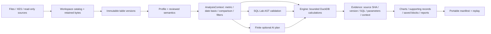

# Architecture and trust boundaries

`app.py → workspace_ui.main → universal.ui` is the only product entry. The shell
imports presentation tokens without loading old application engines. Legacy UI
route selectors are removed. The CLI/ingestion and earlier domain libraries stay
inside an explicit compatibility boundary; no existing data is auto-migrated.

The semantic catalog contains row grain, role per field, units and date purpose.
Explicit metric/date/grouping choices persist per data version; a sole reviewed
saved metric can become the initial objective. Multiple competing definitions
require a choice. Invalidated definitions remain visible for review.
Review creates a version-bound semantic snapshot. A preparation operation creates
a new immutable table and requires another review. Undo restores a prior review.
A saved analysis can replay the old version without changing the active catalog.

`Metric` parses a small Python expression AST, never `eval`. Allowed aggregate
functions compile quoted column literals and validated constants to SQL.
Row-derived arithmetic supports products and ratios, quantiles, conditional sums,
weighted averages and ratios of separately aggregated components. Finite numeric
inputs only; empty/all-missing sums remain unavailable; division by zero is NULL.
Weighted averages use complete value/weight pairs and return unavailable for
negative weights. Explicit reviewed input units reject incompatible addition or
subtraction. More complex dimensional analysis is a limitation, not a claimed
universal unit algebra. Metric dictionaries expose dependencies, formula,
denominator annotation, currency, aggregation behavior and review status.

Every ordinary analytical page constructs the same `Engine` and
`AnalysisContext`. Active filters become parameterized predicates in `selected`.
Trusted algorithms generate SQL; user/model input cannot call that execution API
through the UI. Results include executed SQL/parameters, filters, context,
immutable version and source hash; their evidence ID hashes these inputs.

SQL Lab accepts one parsed SELECT or nonrecursive CTE. A hierarchical AST walk
checks prior CTE visibility, prevents shadowing of approved sources, denies raw
catalog/schema references and table functions, restricts scalar/window functions
and checks each join against a saved relationship. Only the active fact and its
version-validated, unique-key related dimensions enter the source catalog.
Left joins retain unmatched rows; exact text equality preserves leading zeros.
A dimension is explicitly labeled unfiltered; shared filters apply to the fact.
CTE/subquery joins, chain joins, self joins and multiplication are deliberately
rejected. The UI explains the supported direct join pattern.

Execution adds logical-source CTEs inside the already-filtered Engine query. A
read-only connection disables external access and unsigned extensions. A timer
interrupts expensive execution; connection memory and thread budgets apply.
Paging limits materialized results; sorts/aggregations still require work before
paging, hence time/memory safeguards. EXPLAIN validates the same query before
planning. No extension, filesystem/network reader, dynamic SQL, secret/settings
function or mutation is exposed. The function allowlist fails closed on unknown
functions. This is an application boundary for a trusted local user, not a
multi-tenant database service or OS-level security guarantee.

Saved queries, views and report blocks live in an additive `_saved_objects`
metadata table created only on explicit save. Query execution and reopening
validate retained source/version context. Reports escape imported text and keep
per-block evidence when combining selections. Spreadsheet exports escape
formula-like strings. Saved evidence can contain source records; it remains local
and must be reviewed before sharing.

Generic event analysis takes an explicitly selected entity, activity and reviewed
event timestamp. The generic case table exposes structural identity and complete raw attribute
JSON, without manufacturing domain columns. The original normalized parser DB
remains available through compatibility. It produces full selected-cohort direct-follow counts, elapsed
UTC hours and top sequences within a 50,000-event bound. Timestamp ties use source
row order and are disclosed. This is not conformance checking, a verified
completion model, or a procurement-specific process definition. XES import reuses
the prior streaming parser and retains both source and parser database.

The optional AI provider receives schema, selected metric and user question after
consent. It can return only `summary`, `groups` or `trend`; local code executes the
validated plan and constructs the numeric response. Unsupported intent fails
explicitly. No live provider result is claimed in this release.
