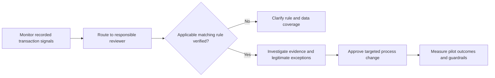

# Business analysis package — working draft

All stakeholders, priorities and acceptance criteria below are simulated portfolio requirements. No interviews, approvals or sign-offs occurred. Quantitative findings on real company data are pending.

## Business case

The hypothetical Head of Procurement Operations needs visibility into delays, repeated handling and exceptions. The question is: where do these occur, and which improvements merit investigation? The project does not assume inefficiency.

Objectives: build reproducible reporting, distinguish process grains, reveal recorded variants and waiting intervals, and make investigations auditable. Success means reconciled counts, defensible KPI definitions, category-aware interpretations, traceable management decisions and an interviewer-reproducible demonstration.

In scope: recorded PO-item event sequences, quality checks, descriptive mining, reporting and controlled analytical assistance. Out of scope: supplier identification, causal proof, production automation, payment execution, enterprise deployment and actual savings certification. Constraints include anonymization, incomplete business semantics, possible censoring, Windows-only Desktop validation and API access costs.

Risks: misleading aggregates, mistaking repeats for waste, applying the wrong matching rule, misinterpreting batch users, right censoring, ungrounded LLM narratives and exposing imported values to an external provider. Mitigations are explicit grain, raw retention, unknown classifications, evidence review and opt-in provider use.

## Stakeholders and needs

| Stakeholder | Simulated need | Proposed responsibility |
|---|---|---|
| Sponsor / Procurement Operations | Prioritized evidence | Own scope and benefit hypotheses |
| Finance Director | Financial assumptions separated from observations | Review scenario inputs |
| AP Manager | Matching-flow exceptions | Validate applicable invoice rules |
| Process Owner | Variants and bottlenecks | Validate operational interpretation |
| Compliance Manager | Provenance and defensible classifications | Approve normative rules before use |
| IT / Data Engineering | Repeatable import and secure access | Operate data pipeline |
| Operational users | Understandable investigations | Execute proposed UAT, no sign-off claimed |

## BRD and traceability

| ID | Priority | Measurable requirement / acceptance | Implementation / validation |
|---|---|---|---|
| FR01 | Must | Import XES/XES.gz preserving raw bytes; reject malformed identifiers atomically | ingest.py; malformed/gzip tests |
| FR02 | Must | Reproduce counts at item/event/document grains and source comparison | quality(); independent reference tests |
| FR03 | Must | Stable timestamp ordering retaining original position | ordered_events; tie/reversal tests |
| FR04 | Must | Compute spans, variants, repetitions and transition intervals | model.sql; 20-question references |
| FR05 | Must | Distinguish category-aware deviations from suspicious sequences | review-only sequence_signals; normative rules pending |
| FR06 | Must | Four genuine Power BI report pages and semantic measures | generated candidate; Windows acceptance pending |
| FR07 | Must | Execute read-only SQL with inspectable evidence | Analyst; access restriction tests |
| FR08 | Should | Natural-language investigation with tool calls and audit | optional provider integration; mocked protocol tested |
| FR09 | Must | Work without LLM credentials | deterministic catalog; app tests |
| FR10 | Must | Human approval before report modifications | no report-write agent tool; proposal export approval |
| NFR01 | Must | Do not disclose credentials or execute arbitrary shell from LLM | environment-only credentials; controlled tool surface |
| NFR02 | Must | Process original volume within measured Mac resource envelope | streaming design implemented; full-volume benchmark pending |
| NFR03 | Must | Disclose provenance, filters and limitations beside results | quality report/UI; real-data validation pending |
| DR01 | Must | Verify source license and field semantics before findings | blocked on official record access |
| RR01 | Must | Reconcile Power BI DAX against independent SQL in same filter context | SQL references present; DAX execution pending |

## Current-state analysis

No real current-state map is published yet. The discovery command generates recorded directly-follows edges and start/end activities from an imported log. Synthetic tests exercise this machinery without implying the company's process. Validate category-specific decision points against documentation and subject-matter review before drawing a BPMN gateway. Duration, resource type and completion must not be inferred from a diagram alone.

## Proposed future state (hypothesis, not observed improvement)

This is a proposed exception-management loop, not a reconstructed procurement workflow or a claim that these activities appear in the event log. A compliant BPMN deliverable remains pending operational evidence.

## Prioritized backlog and user stories

| Priority / ID | Story / change | Evidence gate | Acceptance / target | Impact / effort hypothesis |
|---|---|---|---|---|
| P0 / B01 | As an analyst, verify original source and counts | Original XES, license and field guide | Every count mismatch explained; no dropped records | High / low-medium |
| P0 / B02 | As AP owner, define flow-specific matching and completion rules | Authoritative documentation and SME validation | Versioned rule table; tests for each category and incomplete case | High / medium |
| P1 / B03 | As manager, inspect trustworthy Power BI measures | Desktop with official data | Four pages refresh; identical SQL/DAX filter context | High / medium |
| P1 / B04 | As process owner, prioritize a transition pilot | Stratified volumes and waits with sample-size checks | Agreed median/P90 target and no exception-rate deterioration | Potentially high / medium |
| P2 / B05 | As an AP user, receive early exception routing | Validated signal precision and ownership | Measure time-to-review and false positives in pilot | Unknown / medium-high |
| P2 / B06 | As analyst, use LLM assistance safely | Paid API/access and benchmark review | All answers cite queries; unsupported claims rejected in review | Medium / medium |

Process-change specification: choose one verified category and eligible cohort; assign an owner; define signal, routing SLA, escalation and override reasons; log reviewer decisions; run a limited pilot with a comparison cohort; measure outcome distributions and false-positive burden; stop or roll back on control deterioration. These operational fields are absent from the public log and require new instrumentation.

## UAT scenarios (not executed by stakeholders)

| Scenario | Expected result | Status |
|---|---|---|
| Import official source | Published counts compared; mismatches investigated | Blocked: original unavailable |
| Same timestamp events | Source-position order retained and caveat visible | Automated fixture check passed |
| Repeated receipt | Retained, flagged as repeat; not automatically noncompliant | Automated fixture check passed |
| Invoice before receipt in a different category | Review signal only; rule applicability explicit | Automated fixture check passed |
| Missing completion event | Completion unknown; no claim of completed cycle time | Automated fixture check passed |
| SQL filesystem/network attempt | Request rejected | Automated fixture checks passed |
| Offline API credentials | Deterministic investigation works | Automated app check passed |
| Power BI refresh and slicers | Desktop renders correct values and filters | Manual test outstanding |
| LLM business question | Executed SQL shown; narrative checked independently | Mocked transport only; live UAT outstanding |

## Management decision brief

Decision requested in a future stakeholder exercise: authorize source/rule verification and a measured pilot only after analysis, rather than approve an unquantified automation rollout. There are no verified company bottlenecks, compliance violations or savings yet.

Scenario formula, **hypothetical only**: annual benefit = eligible annual cases × assumed saved minutes / 60 × assumed labor cost per hour − annual operating cost; net first-year benefit additionally subtracts implementation cost. The log does not establish annual eligibility, realizable capacity release or actual euro costs. Do not populate them with anonymized spend values. Compare sensitivity ranges and explicitly account for adoption and false-positive review cost.
