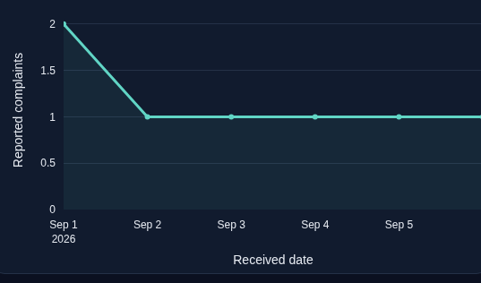
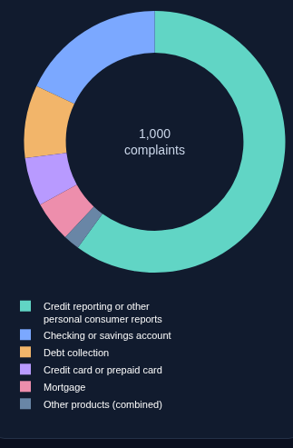

# CFPB timestamp and donut correction

The reported genuine CSV contains 81,915 complaints (approximately 27 MB). **That file is unavailable in this cloud workspace.** The checks here use explicitly synthetic records with the exact reported timestamp syntax; they do not validate the full source or its business findings.

## Update the existing Mac checkout

Stop Streamlit with **Control-C** before updating, so its imported modules and cached results are replaced. From your existing DA_project directory:

```sh
git fetch origin
git switch feature/insightpilot
git pull --ff-only origin feature/insightpilot
uv sync --frozen --extra test --python 3.12
uv run --frozen streamlit run app.py --server.port 8501 --server.headless false
```

This updates the existing feature branch and PR #1. It does not merge into main. No API key is needed. Run these commands on your Mac; the cloud server does not expose a public preview.

## Replace the invalid imported snapshot

**The original CSV is the source for reimport. Do not reuse the old DuckDB database or an export containing its NULL dates.** Updating Python code does not rewrite previously imported dates.

1. Open **Customer Experience & Risk Intelligence**. The old snapshot may now show a clear “no usable received dates” error.
2. Expand **Load another complaint snapshot** in the sidebar. These import controls remain available even when the old snapshot is invalid.
3. Under **CFPB CSV export**, select your original 81,915-complaint CSV. Leave **This complaint file is synthetic test data** unchecked for that genuine source.
4. Click **Import complaint CSV**. The application creates a new immutable snapshot and automatically selects it. The original source is retained, and the new dataset ID resets filters/current answers.
5. Check the imported count against 81,915. If it differs, inspect the declared invalid-ID/duplicate-ID exclusions. No complaints are removed merely because some dates are missing or invalid.
6. Review **Source received-date quality**, the daily trend, coverage dates and a single-day date filter. The source quality caption separates missing dates from invalid values; the executive caption reports the selected cohort’s combined trend exclusions.
7. Under **Advanced / Developer Tools → Quality & provenance**, confirm `date_parser_version: 2`, the date policy, source hash and quality counts. Retire the old snapshot from analytical use. After validating the replacement, you may archive its old import directory outside `data/workspaces` and `data/cfpb`; keep the original CSV.

A manual upload remains labeled user supplied because the application cannot authenticate the browser download. That label does not assert that your genuine file is synthetic.

## CLI reimport and independent validation

Alternatively, stop Streamlit and run the following. Change **only the first path** to your original CSV’s actual location. The target database must be new; if this target already exists, choose a new directory name.

```sh
CFPB_CSV="$HOME/Downloads/your-original-cfpb-file.csv"
uv run --frozen insightpilot cfpb-import "$CFPB_CSV" data/cfpb/date-fix-v2/analytics.duckdb
uv run --frozen insightpilot cfpb-validate "$CFPB_CSV" data/cfpb/date-fix-v2/analytics.duckdb
uv run --frozen insightpilot cfpb-analyze data/cfpb/date-fix-v2/analytics.duckdb outputs/cfpb-date-fix-v2
uv run --frozen streamlit run app.py --server.port 8501 --server.headless false
```

Choose the newly imported snapshot in **Active dataset**. `cfpb-validate` must report `passed: true`; investigate any failed check before relying on its results. It uses a separately implemented pandas date parser and Python counters, rather than the production parser, to reconcile received-date distributions, complaint counts, product/issue distributions, company counts, company/product comparisons and response totals. Company validation includes the full long tail beyond the dashboard’s bounded ranking.

`cfpb-analyze` regenerates the management brief, case study, Parquet, manifest and query/source-validation evidence from the corrected snapshot. Replace previous exports that carried invalid dates. If Power BI uses those exports, refresh it from the new Parquet and verify its dates separately.

## Date interpretation

| Source value | Stored calendar date |
|---|---|
| `2026-09-02T19:36:07.000Z` | `2026-09-02` |
| `2026-09-02T19:36:07.123456+00:00` | `2026-09-02` |
| `2026-09-02T00:30:00+02:00` | `2026-09-01` after UTC conversion |
| `2026-09-02T23:30:00-05:00` | `2026-09-03` after UTC conversion |
| `2026-09-02T19:36:07` | `2026-09-02`; offset-free timestamps use UTC |
| `2026-09-02` / `09/02/2026` | `2026-09-02`; existing date-only conventions retained |
| Blank / invalid date such as February 30 | NULL, counted and disclosed |

The same parser handles **Date sent to company**. Received-date filters use inclusive calendar-date bounds. Period comparisons use adjacent equal-length windows inside the corrected source coverage, exclude/disclose an unmatched final day, and leave growth undefined when the earlier count is zero. An entirely unusable received-date column fails before a database is created. An old all-NULL-date snapshot displays an explicit reimport error instead of empty charts.

## Donut interpretation

The chart keeps up to five products representing at least 3% each, combining smaller and remaining products into **Other products (combined)**. SQL computes that grouping across the full selected cohort. Product-share calculations remain available at their original detail level in the analytical evidence.

The slices have no competing labels/percentages on their arcs. A wrapped vertical legend sits below the chart, and hover shows the full product name, exact count and share of all selected complaints. Use the Product sidebar filter to change that population; legend items act as a key rather than silently changing the denominator. Very long legend names are shortened for display, with their full value retained in hover.

## Validation scope

- A hand-counted 12-row regression CSV retains 10 unique valid complaints: 7 dated, 1 missing date and 2 invalid dates. Its daily counts are **2, 1, 1, 1, 1, 1**. Product counts are **5 / 5**; named companies each have **5** complaints. Equal-period issue counts, company/product cells and compound filters are checked against explicit reference values.
- A separate **1,000-row synthetic layout fixture** uses the exact timestamp form and long product names. Its product counts **600, 180, 90, 60, 50, 10, 5, 3, 2** become donut counts **600, 180, 90, 60, 50, 20**, preserving the full denominator. It is not a sample from your genuine file.
- Browser checks inspect rendered legend bounding boxes and actual hover text at **1280×800** and **1440×900**, then exercise company/date filters and original-CSV reimport. This is Chromium on Linux with MacBook-sized viewports, not a native Mac execution claim.

Actual results and screenshots are linked from [validation.md](validation.md). Full 81,915-record acceptance still requires reimporting your original CSV and running the independent validation on your Mac.

## Actual corrected-chart screenshots

These are captures of the running application with **synthetic regression data**, not the genuine 81,915-record file.

[1280-pixel MacBook viewport donut](screenshots/date-fix/SYNTHETIC-donut-1280.png) · [1440-pixel viewport](screenshots/date-fix/SYNTHETIC-donut-1440.png) · [20 complaints / 2.00% tooltip](screenshots/date-fix/SYNTHETIC-donut-hover.png) · [reimported snapshot and quality counts](screenshots/date-fix/SYNTHETIC-date-reimport.png)




